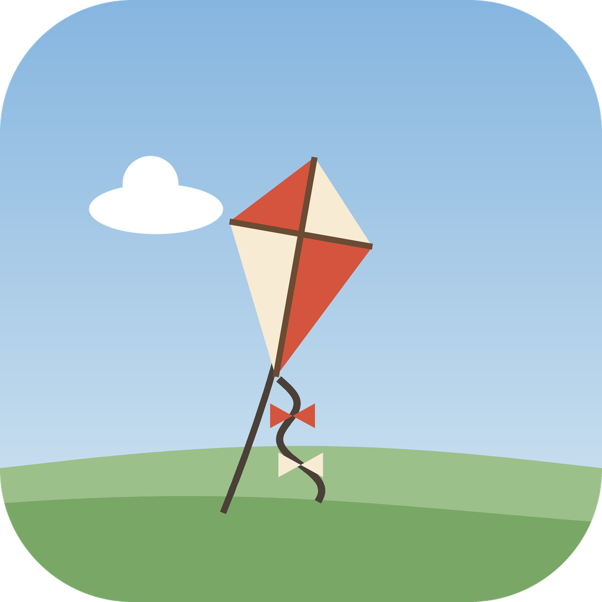
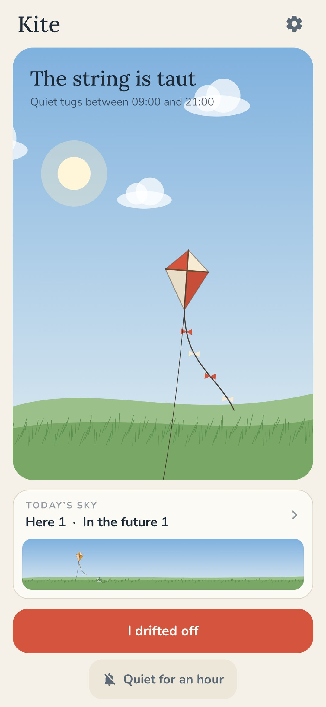
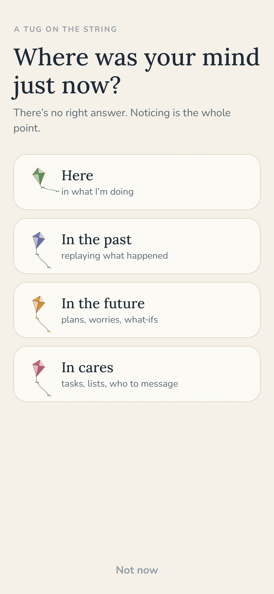
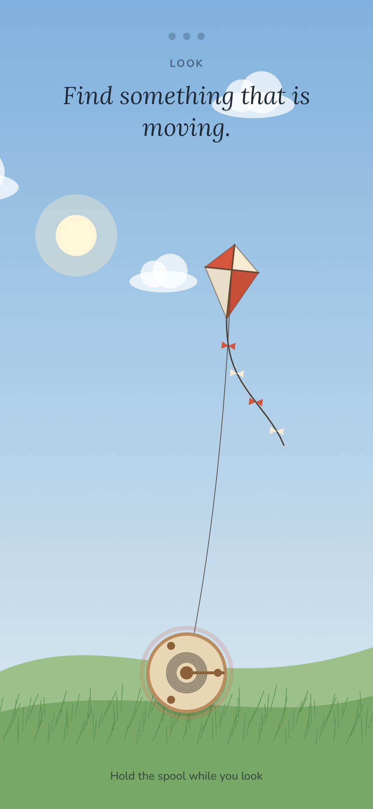
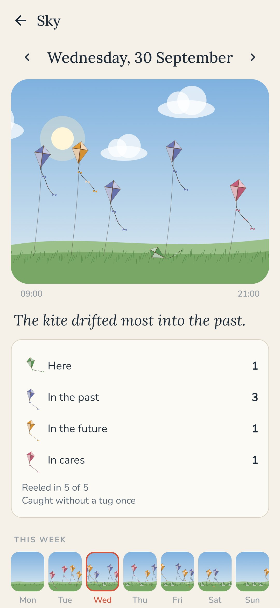

<div align="center">



# Kite

### Your mind is a kite. Reel it back in.

*A few times a day, a soft buzz and one question: where are you? Here, in the past, in the future, or in cares. One tap. If you'd drifted, fifteen seconds of holding a spool while you find one thing you see, one sound and one feeling, and the kite comes down into the grass. Free, no ads, no account, no internet.*

[](https://github.com/bigdevwhale/kite/actions/workflows/android.yml)
[](https://github.com/bigdevwhale/kite/releases/latest)


[](LICENSE)

**English** · [Русский](README.ru.md) · [Changelog](CHANGELOG.md)

   

</div>

---

## The idea

During the day your thoughts fly off like a kite on a long string. You're answering an email and replaying yesterday's conversation, walking to the shop and rehearsing next week's meeting. It isn't a failing; it's what minds do. What helps is noticing it and coming back, again and again, in small moments in the middle of an ordinary day.

Kite tugs the string now and then. You answer honestly, and if you'd drifted, you reel the string in.

## How it works

1. **A tug.** A few times a day, at moments you can't guess, the phone buzzes softly: *Where are you?* No sound. The tugs are spread evenly across the hours you pick and never come in a bunch.
2. **One tap.** *Here*, straight from the notification, and that's it. Or *I drifted*, and you say where to: **the past** (replaying what happened), **the future** (plans, worries, what‑ifs) or **cares** (tasks, lists, who to message).
3. **Reel in.** The kite is high up. Hold the spool and find **one thing you see**, then **one sound**, then **one feeling in your body**. Each turn of the spool brings the kite lower; the third lays it in the grass. About fifteen seconds, and you're back to what you were doing.
4. **I drifted off.** Caught yourself without a tug? Tap the big button, or the widget on your home screen, and reel in right away.

## The day's sky

In the evening, look up. Every tug is a small kite in the day's sky, placed by the hour: green ones lie in the grass (here), dusk‑blue ones drifted into the past, sunrise‑orange into the future, rose into cares. A kite you reeled in has its string down to the ground; one you let go has a loose end. One line in words says where the mind went most, and the week's skies sit below. No scores, no streaks, no percentages; just the picture.

## Small things

- **Quiet for an hour** for meetings and films, or switch the tugs off altogether.
- **Spool clicks**: light ticks under your finger while you reel.
- The sky follows the clock: dawn, midday, dusk, stars at night.
- Some phones stop apps to save battery. *Settings → Let tugs through* opens the right page.

## Privacy

Everything stays on the phone. There's no account, no internet permission and no analytics. Kite stores only the time of each tug, where you said you were and whether you reeled in.

## Building

```bash
./gradlew testDebugUnitTest assembleDebug              # app.kite.dev, next to a real install
./gradlew assembleDebug -Pdemo                         # app.kite.demo with three weeks of made-up tugs
./gradlew testDebugUnitTest -Prender --tests '*RenderArtScreens*' && python tools/shots.py   # screenshots
```

Releases are built by GitHub Actions from a `v*` tag and signed with the repository's secrets.

## License

[MIT](LICENSE)
