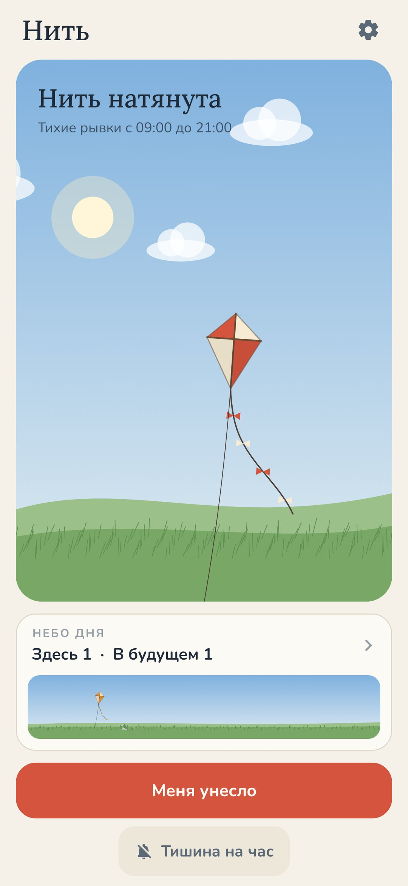
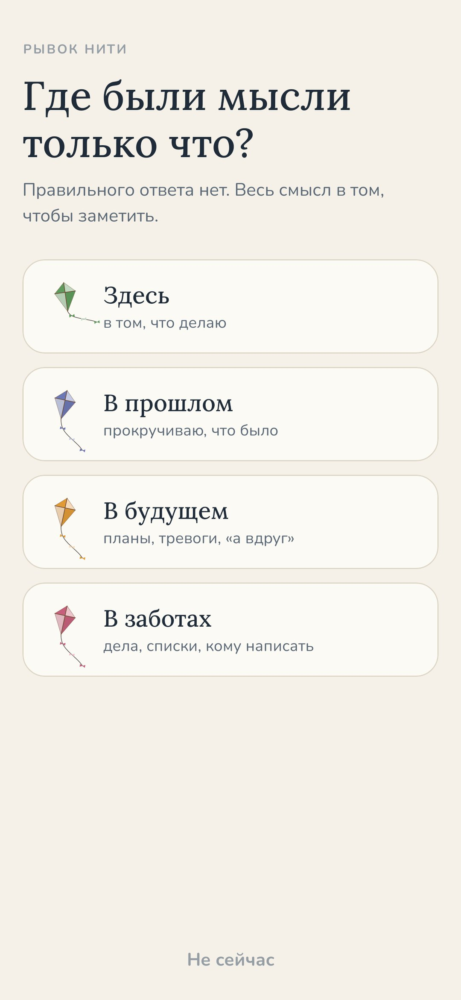
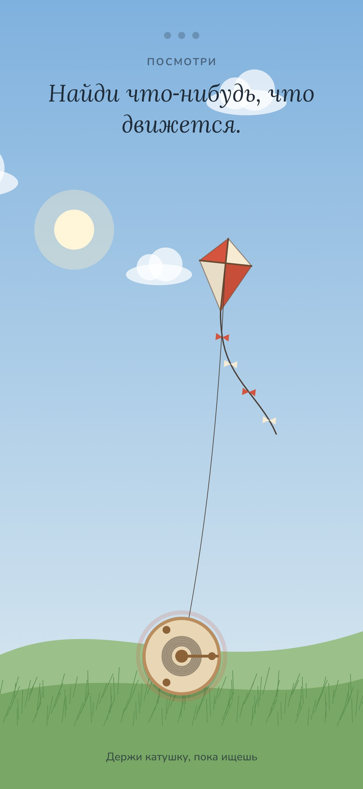
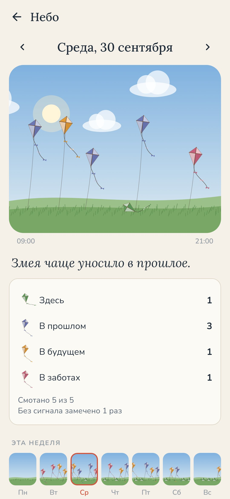

<div align="center">


# Нить

### Мысли — воздушный змей. Смотай нить.

*Несколько раз в день — тихая вибрация и один вопрос: где ты? Здесь, в прошлом, в будущем или в заботах. Один тап. Если унесло — пятнадцать секунд держишь катушку и находишь одну вещь, которую видишь, один звук и одно ощущение, и змей опускается в траву. Бесплатно, без рекламы, без аккаунта, без интернета.*

[](https://github.com/bigdevwhale/kite/actions/workflows/android.yml)
[](https://github.com/bigdevwhale/kite/releases/latest)


[](LICENSE)

[English](README.md) · **Русский** · [Изменения](CHANGELOG.md)

   

</div>

---

## Идея

Днём мысли улетают, как воздушный змей на длинной нити. Отвечаешь на письмо — а в голове вчерашний разговор. Идёшь в магазин — а репетируешь встречу на следующей неделе. Это не поломка, так устроена голова. Помогает одно: замечать и возвращаться, снова и снова, маленькими моментами посреди обычного дня.

Нить время от времени дёргает за змея. Ты честно отвечаешь, а если унесло — сматываешь нить.

## Как это работает

1. **Рывок.** Несколько раз в день, в моменты, которые не угадать, телефон тихо вибрирует: *Где ты?* Без звука. Рывки ровно распределены по выбранным часам и никогда не идут подряд.
2. **Один тап.** *Здесь* — прямо из уведомления, и всё. Или *Унесло* — и выбираешь куда: **в прошлое** (прокручиваю, что было), **в будущее** (планы, тревоги, «а вдруг») или **в заботы** (дела, списки, кому написать).
3. **Смотать нить.** Змей высоко. Держи катушку и найди **одну вещь, которую видишь**, потом **один звук**, потом **одно ощущение в теле**. Каждый оборот катушки опускает змея ниже, третий кладёт его в траву. Секунд пятнадцать — и ты снова в своём деле.
4. **Меня унесло.** Унесло без всякого сигнала? Нажми большую кнопку или виджет на главном экране и сразу смотай нить.

## Небо дня

Вечером посмотри наверх. Каждый рывок — маленький змей в небе дня, по часам: зелёные лежат в траве (здесь), сумеречно‑синих унесло в прошлое, рассветно‑оранжевых — в будущее, розовых — в заботы. У смотанного змея нить тянется до земли, у отпущенного — болтается свободный конец. Одна строка словами говорит, куда уносило чаще, а ниже — небо всей недели. Ни очков, ни серий, ни процентов, просто картина.

## Мелочи

- **Тишина на час** — для встреч и кино, или выключи рывки совсем.
- **Щелчки катушки** — лёгкие щелчки под пальцем, пока сматываешь.
- Небо идёт за часами: рассвет, полдень, закат, звёзды ночью.
- Некоторые телефоны останавливают приложения ради батареи. *Настройки → Пропустить рывки* открывает нужную страницу.

## Приватность

Всё остаётся на телефоне. Нет аккаунта, нет разрешения на интернет, нет аналитики. Нить хранит только время рывка, куда, по твоему ответу, унесло мысли и смотана ли нить.

## Сборка

```bash
./gradlew testDebugUnitTest assembleDebug              # app.kite.dev, рядом с настоящей установкой
./gradlew assembleDebug -Pdemo                         # app.kite.demo с тремя неделями выдуманных рывков
./gradlew testDebugUnitTest -Prender --tests '*RenderArtScreens*' && python tools/shots.py   # скриншоты
```

Релизы собирает GitHub Actions по тегу `v*` и подписывает секретами репозитория.

## Лицензия

[MIT](LICENSE)
